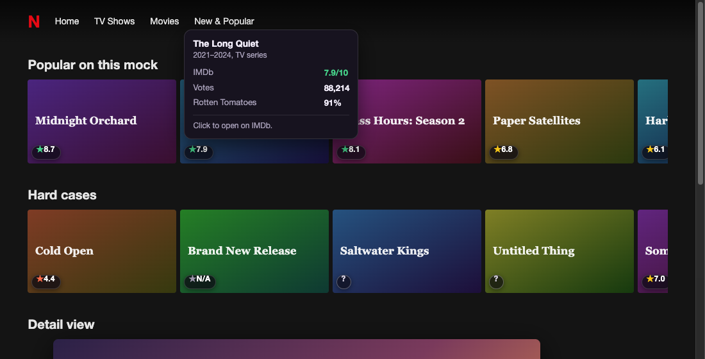
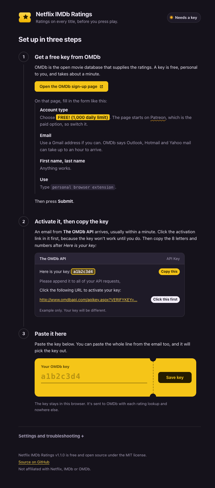
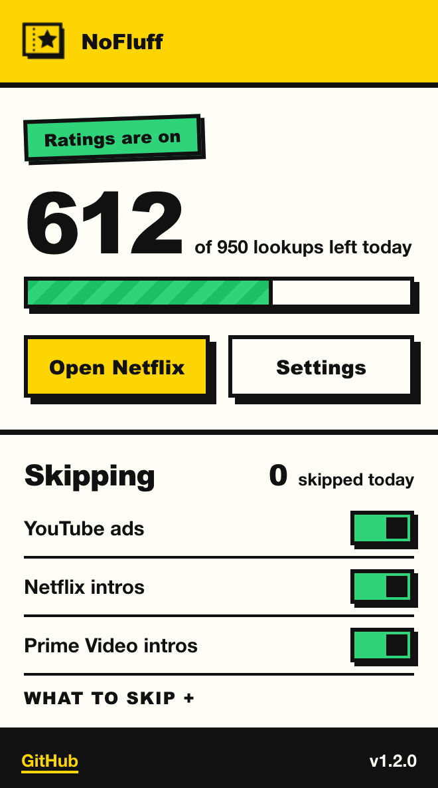

# NoFluff

**Scores in. Fluff out.** A Chrome extension that does two things:

1. **Ratings.** Puts IMDb, Rotten Tomatoes and Metacritic ratings directly on Netflix, on the
   row cards and on the detail page, so you can judge something before you commit two hours
   to it. Netflix hides external ratings on purpose. This puts them back.
2. **Skipping.** Clicks Skip for you: YouTube ads, and the intro, recap and credits buttons on
   Netflix and Prime Video. It works in fullscreen. (This half used to be a separate
   extension called Skip It. It lives here now.)

**[Website](https://rushilbh27.github.io/netflix-imdb/)** has a live demo, the install steps and an FAQ.




*Titles above are fictional, from the [mock page](#try-it-without-netflix) used for development.*

---

## Contents

- [Install](#install)
- [Get your free API key](#get-your-free-api-key) (needed once, takes about a minute)
- [What the badges mean](#what-the-badges-mean)
- [Skipping](#skipping) (needs no key, works right after install)
- [About](#about)
- [How it works](#how-it-works)
- [When it breaks](#when-it-breaks)
- [Troubleshooting](#troubleshooting)
- [Privacy](#privacy)
- [Contributing](#contributing)

---

## Install

There is no Chrome Web Store listing, so you load it yourself. It takes about two minutes
and works in any Chromium browser: Chrome, Edge, Brave, Arc, Opera.

**1. Get the code**

```bash
git clone https://github.com/rushilbh27/netflix-imdb.git
```

No git? On the repo page press the green **Code** button, choose **Download ZIP**, and
unzip it somewhere you will not delete it. Chrome loads the extension from that folder, so
if the folder moves or disappears the extension stops working.

**2. Load it into Chrome**

1. Open `chrome://extensions`
2. Turn on **Developer mode** (top right)
3. Click **Load unpacked**
4. Select the `netflix-imdb` folder

A setup page opens by itself. That is the next section, and the page walks you through it
too. The key is only for ratings: [skipping](#skipping) needs nothing and works as soon as
the extension is loaded. Refresh any YouTube, Netflix or Prime tab that was already open.

> Chrome may show a "Disable developer mode extensions" prompt on later launches. That is
> normal for any unpacked extension. Dismiss it and the extension keeps working.

---

## Get your free API key

The ratings come from [OMDb](https://www.omdbapi.com/), a free movie database. It needs a
key that belongs to you. This keeps the extension free to run with no server behind it, and
means you are never sharing someone else's rate limit. It takes about a minute, once.



### Step 1: Request a key

1. Go to **[omdbapi.com/apikey.aspx](https://www.omdbapi.com/apikey.aspx)**
   (the extension's setup page has a button that opens it)
2. **Account type: choose `FREE! (1,000 daily limit)`.**
   The page starts on **Patreon**, which is the paid option. Switch it.
3. **Email:** use a Gmail address if you can. OMDb warns that Outlook, Hotmail and Yahoo
   mail can take up to an hour to arrive.
4. **First name, last name:** anything.
5. **Use:** type `personal browser extension`.
6. Press **Submit**.

No password, no credit card. It is a form and an email.

### Step 2: Activate it and copy the key

An email from **The OMDb API** arrives, usually within a minute. It looks like this:

```
Here is your key: a1b2c3d4

Please append it to all of your API requests,

OMDb API: http://www.omdbapi.com/?i=tt3896198&apikey=a1b2c3d4

Click the following URL to activate your key:
http://www.omdbapi.com/apikey.aspx?VERIFYKEY=23c8bc67-eaa7-...
```

1. **Click the activation link first** (the one with `VERIFYKEY=`). The key will not work
   until you do.
2. **Copy the key**: the 8 letters and numbers after *Here is your key:*

Be careful not to copy the long code after `VERIFYKEY=`. That is the activation code, not
your key. (If you do, the extension will notice and tell you.)

### Step 3: Paste it into the extension

Paste the key into the yellow ticket on the setup page. It checks the key against OMDb
straight away and saves it if it works. You can paste just the key, the whole
`Here is your key:` line, or the entire email, and it will pick the key out.

The moment it says **Ratings are on**, open Netflix. No reload needed, because any Netflix
tab you already had open updates by itself.

Lost the setup page? Click the extension's icon in the toolbar, then **Settings**.

---

## What the badges mean

Each title card gets a small badge at the bottom-left. Hover it for the full picture: the
IMDb score, vote count, Rotten Tomatoes and Metacritic. Click it to open the title on IMDb.
Open a title to see all three scores together in a panel above its details.

| Badge | Meaning |
|---|---|
| Green **★ 8.4** | Great. 7.5 and up. |
| Yellow **★ 6.8** | Decent. 6.0 to 7.4. |
| Red **★ 5.1** | Weak. Under 6.0. |
| Grey **★ N/A** | Matched correctly, but IMDb has no rating yet. Common for brand new titles. |
| White **?** | Not sure which IMDb title this is. Click to search IMDb yourself. |
| Black **★ Set up** | No key saved yet. Click to open setup. |

---

## Skipping

NoFluff clicks the Skip button the moment it shows up, and tells you it did with a small
yellow sticker in the corner. Nothing to configure.

| Where | What it skips |
|---|---|
| YouTube | Skippable video ads, static (image) ads, and the little ad banners you can close |
| Netflix | Skip Intro, Skip Recap |
| Prime Video | Skip Intro, Skip Recap, Skip Credits |

It works in fullscreen. The popup (toolbar icon) has a switch per site, a switch per skip
type, and a counter of what it skipped today.

**What it does not do.** It never touches ads YouTube does not let you skip, and it does not
block ads. It only presses the Skip button YouTube itself offers. It also does not click
"Next episode".

**How YouTube ads get skipped.** YouTube ignores clicks made by scripts, so there are three
steps, tried in order until the ad goes away:

1. A plain click, then a full mouse-event sequence.
2. For video ads, jumping the ad to its end (only once the ad is skippable).
3. For static ads, which have no video to jump, a real click sent through Chrome's
   `debugger` API. Chrome shows a **"NoFluff started debugging this browser"** bar for a few
   seconds when this happens. That is expected, and it goes away by itself. This is the only
   reason the extension asks for the `debugger` permission.

Netflix and Prime need only the plain click.

---

## About

There were already two popular extensions that did this: **Trim** (50,000 users) and
**IMDb Ratings for Netflix™** (10,000 users). Around August 2026 both broke, within weeks of
each other, and stayed broken. Their review pages turned into a wall of "doesn't work
anymore".

They broke for the reason almost every Netflix extension eventually breaks: they anchored
to Netflix's obfuscated CSS class names, and Netflix regenerates those every few releases.
One of them also routed every lookup through a third-party server that went down and later
got flagged by an endpoint-security vendor.

This is a rebuild that takes both failure modes seriously:

- **No backend.** Your browser talks to the OMDb API directly with your own key. There is no
  server in the middle to go down, get flagged, or quietly collect what you watch.
- **No CSS class selectors.** Cards are located through routing hrefs (`/watch/`, `jbv=`)
  and `data-uia` test attributes, things Netflix cannot churn without breaking its own site
  and test suite.
- **No confident wrong answers.** See [Matching](#matching).

It is small on purpose: plain JavaScript, no dependencies, no build step.

---

## How it works

```
Netflix page
    │
    │  content.js: finds cards via hrefs + data-uia, injects badges,
    │              only requests ratings for cards scrolled into view
    ▼
background.js: holds the key, queues and rate-limits requests,
    │          caches results for 30 days, scores match confidence
    ▼
OMDb API
```

The content script never sees your API key and never touches the network. Every request goes
through the service worker, which is also where caching, the daily cap and the queue live.

### Matching

Netflix does not expose IMDb IDs anywhere in its page, so titles have to be matched by name.
This is genuinely imperfect, and it is the most common complaint about every extension in
this category ("matches the wrong movie so many times").

The approach here:

1. Strip Netflix's suffixes: `The Crown: Season 5` becomes `The Crown`, which is what OMDb
   actually knows it as
2. Query OMDb, with the year when the page gives one, retrying without it on a miss
3. Score the returned title against the Netflix title using bigram (Dice) similarity
4. **Below 0.6, refuse to show a rating.** The badge turns into a white `?` that links to
   an IMDb search

A `?` means "I'm not confident this is the right title", not "this title has no rating".
That trade is deliberate: a wrong number you trust is worse than no number.

### API quota

OMDb's free tier allows 1,000 lookups a day. In practice you will not get near it:

- Lookups only fire for cards actually scrolled into view
- Results are cached for 30 days, misses for 7
- Identical in-flight lookups are deduplicated
- The worker stops itself at 950 a day, and stops asking when OMDb says the limit is hit

The toolbar popup shows how many you have left today.



---

## When it breaks

It will, eventually. Netflix ships page changes on its own schedule. The extension is built
so that this is a two-minute fix rather than an investigation.

On a browse page with no badges, open the browser console. You should see:

```
[nfimdb] Found 0 title cards on a browse page. Netflix likely changed its DOM.
```

Turn on verbose logging from the setup page (**Settings and troubleshooting**, then the
logging checkbox), reload Netflix, and look for lines starting with `[nfimdb]`.

Then inspect a title card, find a stable attribute on it, and update the `SELECTORS` object
at the top of `content.js`. Every Netflix-specific string in the codebase lives in that one
object, so nothing else needs to change. Reload the extension from `chrome://extensions`.

If you fix it, please open a PR. That is the main way this stays alive.

---

## Troubleshooting

| What you see | What to do |
|---|---|
| Black **Set up** badges | No key saved yet. Click one to open setup. |
| Black **Fix key** badges | OMDb rejected the key. Make sure you clicked the activation link in the email, then paste it again. |
| Setup says "OMDb doesn't recognise that key" | Almost always an un-clicked activation link. Click it, then save again. |
| Setup says "That's the activation code" | You copied the code after `VERIFYKEY=`. Copy the 8 characters after *Here is your key:* instead. |
| No email from OMDb | Check spam. Outlook, Hotmail and Yahoo can take up to an hour. Trying again with a Gmail address is quickest. |
| Grey `–` badges | The daily lookup limit was reached or the request failed. It resets at midnight UTC. |
| No badges at all | Netflix probably changed its layout. See [When it breaks](#when-it-breaks). |
| Skip does nothing on a site that was already open | Refresh the tab. Chrome does not inject an updated extension into tabs that were open before it loaded. |
| A "started debugging this browser" bar appears on YouTube | Expected. It is how static YouTube ads get skipped. It disappears after a few seconds. |
| A YouTube ad was not skipped | Open DevTools, filter the console by `NoFluff`, and open an issue with those lines and the ad's Skip button HTML. |

---

## Privacy

- Your API key is stored in `chrome.storage.local`, scoped to your browser profile. It is not
  synced and not sent anywhere except to OMDb as part of your own lookups.
- The only network destination is `omdbapi.com`. It receives title strings, nothing else.
- No analytics, no telemetry, no backend, no third-party scripts, no remote fonts.
- Host permissions are limited to `netflix.com` and `omdbapi.com`.
- **Skipping** (YouTube ads, Netflix/Prime intros, recaps and credits) runs a
  second content script on `youtube.com`, `netflix.com`, `primevideo.com` and `amazon.*`. It
  reads nothing from those pages and sends nothing anywhere; it only clicks the Skip button.
  Its toggles are in `chrome.storage.sync` and its counter in `chrome.storage.local`.
- The `debugger` permission exists for one case: YouTube ignores scripted clicks on static
  (image) ads, so a real click is sent through the debugger API, only to `youtube.com` pages.
  Chrome shows a "started debugging this browser" bar for a few seconds when that happens.

Everything is readable. There is no minified code. Check for yourself.

---

## Contributing

PRs welcome, especially selector fixes when Netflix changes things. See
[CONTRIBUTING.md](CONTRIBUTING.md).

### Try it without Netflix

Seeing the badges normally needs a Netflix login. To work on the design or the logic
without one, there is a mock browse page with fictional titles and a stand-in for the
`chrome.*` APIs:

```bash
python3 -m http.server 8787
```

| Open | Shows |
|---|---|
| `localhost:8787/dev/mock-netflix.html` | Badges, hover cards and the detail panel, key saved |
| `localhost:8787/dev/mock-netflix.html?key=none` | First-run state: "Set up" badges and the nudge |
| `localhost:8787/dev/preview.html?page=options&key=none` | The setup page |
| `localhost:8787/dev/preview.html?page=popup` | The toolbar popup |

In the setup preview, `a1b2c3d4` is a key the fake OMDb accepts, `limit123` simulates a key
that has hit its daily limit, and anything else is rejected. Nothing in `dev/` is loaded by
the extension itself.

Good first contributions:

- Selector updates after a Netflix change
- Ratings on Prime Video, Disney+ or Hotstar (the architecture allows it; it is not built)
- More skip targets: Disney+ and Hotstar intros, Crunchyroll, Spotify ads
- A toggle to dim or hide titles below a rating threshold
- Better matching for regional titles that Netflix renames

### Project layout

| File | Role |
|---|---|
| `manifest.json` | MV3 config and permissions |
| `content.js` | DOM scanning, badge, hover card and panel injection, the `SELECTORS` block |
| `skipper.js` | The skipping half: finds and clicks Skip buttons on YouTube, Netflix and Prime, shows the sticker, counts skips |
| `background.js` | OMDb requests, cache, rate limiting, queue, match confidence; also the trusted click for static YouTube ads |
| `styles.css` | Everything injected into Netflix |
| `options.html` / `.css` / `.js` | The setup page: key walkthrough, verification, settings |
| `popup.html` / `.css` / `.js` | The toolbar popup: ratings status and quota |
| `skipit-popup.js` | The skipping switches and counter in the popup |
| `ui.css` | Shared styles for the setup page and popup |
| `icons/` | Extension icons (`icon.svg` is the source) |
| `docs/` | The landing page (`index.html`, `landing.css`, `landing.js`) and the README screenshots. Static, no build, no external requests. |
| `dev/` | Mock Netflix page and `chrome.*` stub, for development only |

---

## License

MIT. See [LICENSE](LICENSE).

Not affiliated with Netflix, IMDb, OMDb, YouTube or Amazon. Netflix is a trademark of
Netflix, Inc.; YouTube is a trademark of Google LLC; Prime Video is a trademark of Amazon.com, Inc.
Ratings data comes from the [OMDb API](https://www.omdbapi.com/), an independent service.
